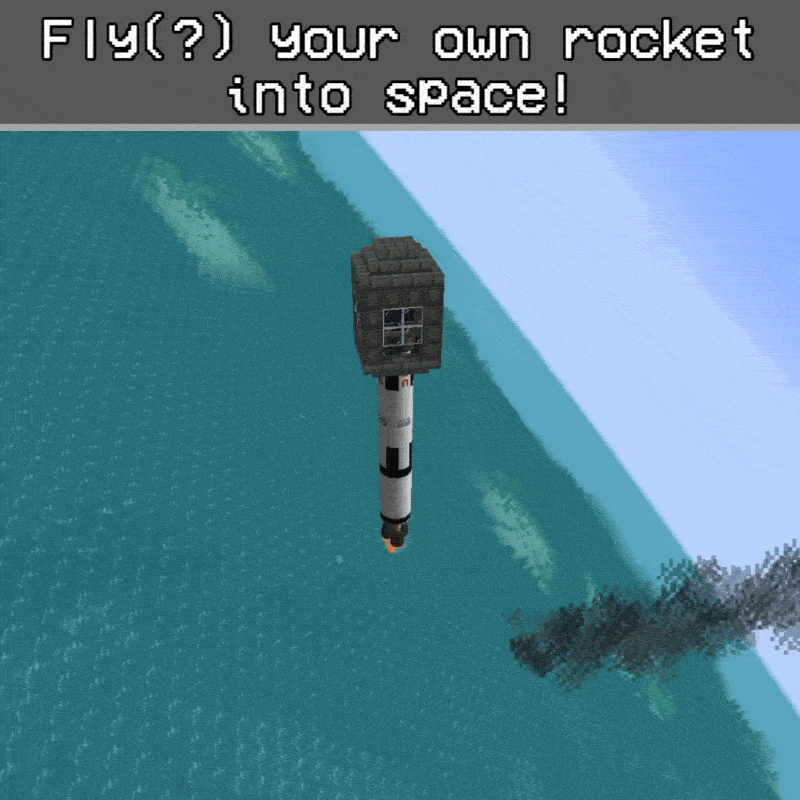
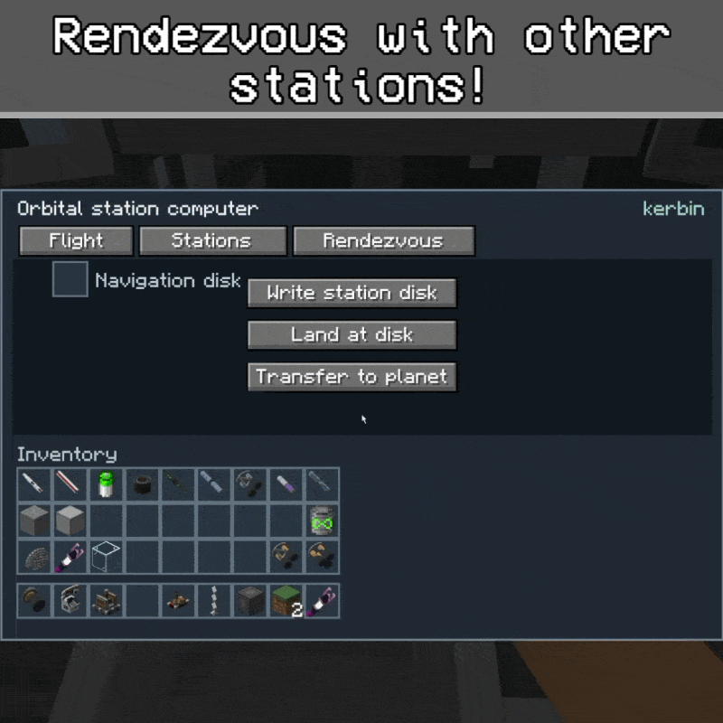
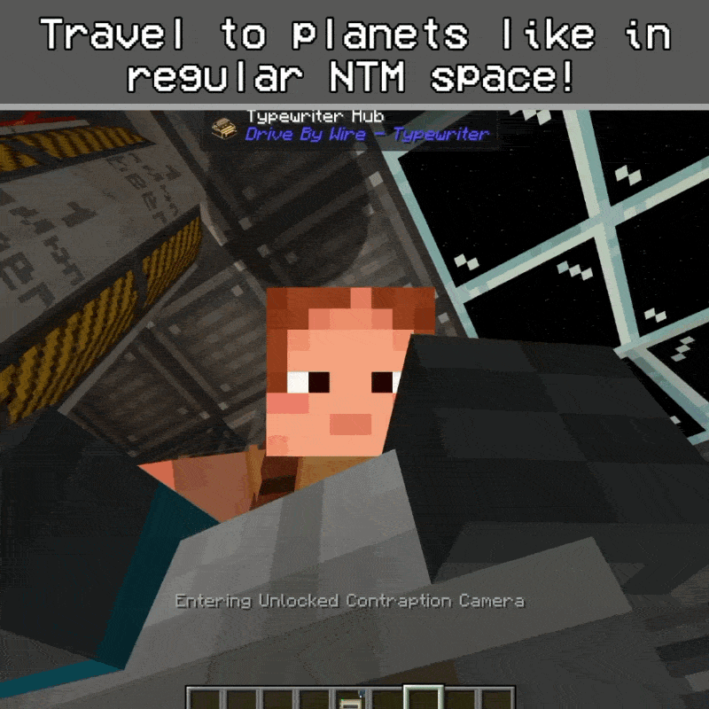
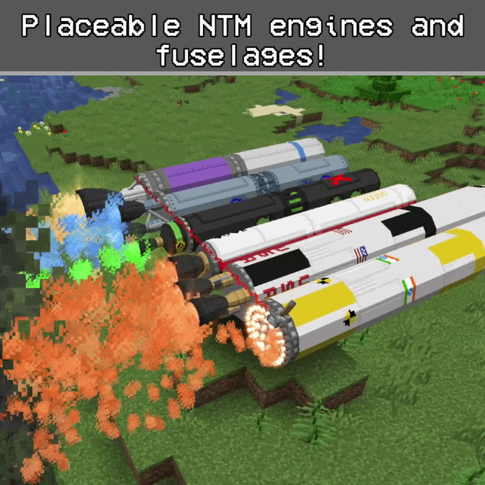
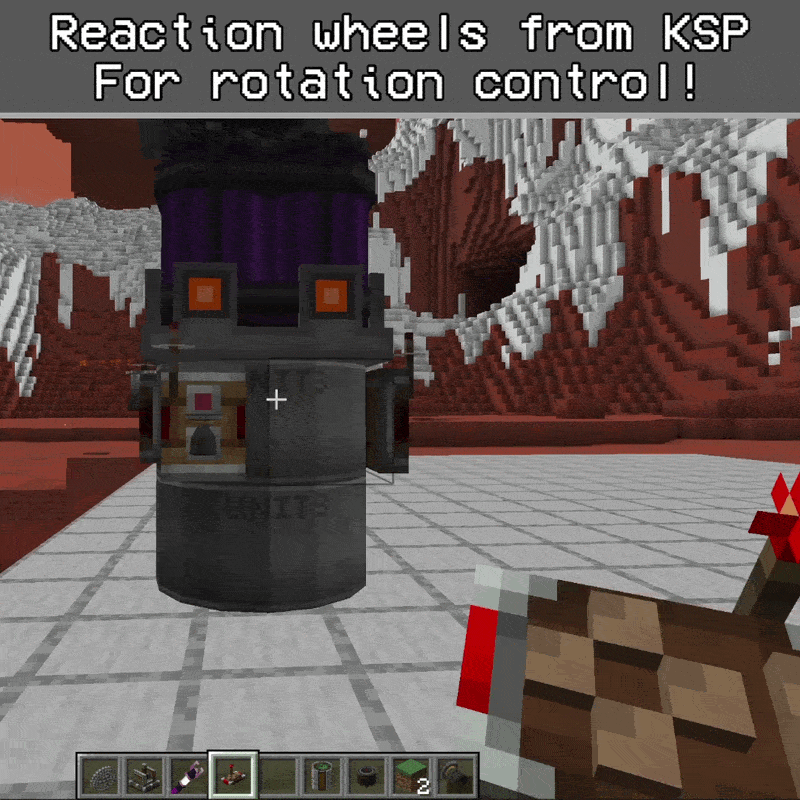

**Sable orbits** is a mod that combines NTM continuum space and Sable and allows you to launch orbital space stations using sable contraptions.

This mod **DOES NOT** add realistic orbital physics.

## Features:

#### To get to space, your ship should reach 2000 on Y axis, then you and your ship will be transported into space!

You can also create a space station the vanilla NTM space way, by building a rocket on the vertical assembly pad, and launching it from a rocket launch pad.

___

#### When in space, use an orbital station computer to rendezvous with other stations in orbit of the same planet!

Unless the station is public, it will need to accept the rendezvous request for you to meet in space

___

#### Use hard drives with an encoded planet and fuelled-up station thrusters to travel between different planets

This mechanic works exactly the same as in regular NTM space, the fact that stations are physical based didn't change that mechanic, you still need to create and process a drive for the planet to travel to it. As mentioned earlier, this mod does not add realistic orbital physics
___
## Smaller features:

#### You can place NTM engines and fuselages to build your rockets!
___

#### For easier rotational control, Sable Orbits adds reaction wheels. They will attempt to kill rotation of the ship when supplied with energy, and will also turn your ship towards the redstone signal

If you stack multiple reaction wheels on top of each other, they will all power each other, and will also all turn your ship if you redstone power just one of the wheels. You can disable them by powering the top or bottom part of the wheel.

### AI disclosure:

AI was used substantially in the code. All assets and descriptions are entirely human made.
The mod is supported, if you find a bug or want to suggest a feature, feel free to visit github

### Planned features:

PIN codes for space station rendezvous instead of request system

Ponder scenes/AEguide entries for some of the features

Fuel tanks and engines explode on large enough impact (Under consideration, maybe it'll be a difficulty setting)

Events in space (i.e. temporary abandoned space stations that you can rendezvous with and loot them/Old satellites falling down from the sky/ space debris flying near your station)

Nukes explode when they hit the ground, and have proper hitbox as opposed to one block like right now

Native docking port to dock two stations together

Better crafting recipes for custom items

Drag inducer ("Engine" for globally stopping a ship in space in both rotation and motion)

Resource pack for square rocket engines and fuselages (To make rocket building more pretty)

Make NTM space air vent push out water from sable sublevel with Create:Deep Seas installed
